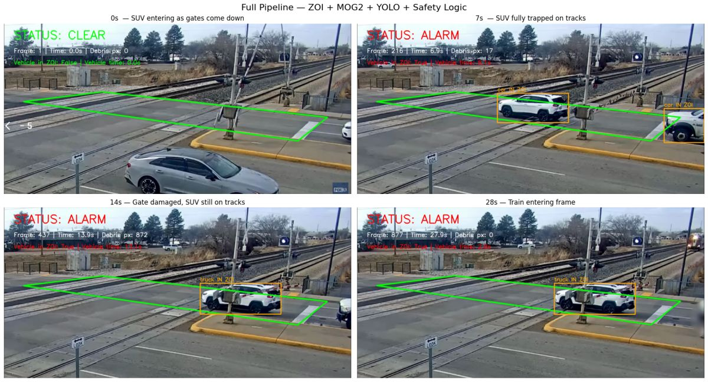

# Audit of the MOG2 + YOLO prototype (September 2026)

This document records what was verified about the prototype that existed in this repository as
of commit `30de329` (notebook `notebooks/MOG2_YOLO_Detection.ipynb`, helper module
`scripts/pipeline_helpers.py`, the tuning script and the three checkpoints), and what the
`gradecrossing/` package does about each point. Every finding below was checked directly against
the committed files, the notebook's stored outputs, the checkpoint headers or a reproduction
script; the evidence is quoted so anyone can re-check it.

Cell numbers refer to the notebook **before** the banner cell was added on 2026-09-11 (so "cell
12" is now the 14th cell). The team's own write-up is `docs/MOG2_YOLO_StressTest_Findings.pdf`.

The findings below are a record of the prototype and are kept as they were written in
September 2026. The right-hand column of the summary says how the package handles each one
**as of the October 2026 integration** (commit `36d58bf` and later); where the September fix
was later replaced, the row says so. The package's own reviews are at the end:
[September](#review-of-the-package-itself-september-2026) and
[October](#second-review-october-2026), followed by the [open items](#open-items).

## Summary

| ID | Severity | Finding | How the package handles it (October 2026) |
|---|---|---|---|
| S1 | critical | Cell 12 alarms the instant any box touches the zone; the vehicle timer and WARNING state are unreachable | **Fixed.** `AlertEngine` decides only from per-object counters (`stuck_seconds`, `near_stuck_seconds`, dwell): WARNING after 1.5 s stopped, ALARM after 3 s. The notebook itself was corrected in `d75b495`. |
| S2 | critical | No class filter: a train, a pedestrian, a bird, any COCO class counts as a "vehicle" | **Fixed.** `detector.vehicle_classes` / `person_classes` / `train_classes`; trains never alert; unmapped classes raise no alert, are listed at start-up and stay visible to the debris backstop; `ignore_classes` drops a class. |
| S3 | high | "In zone" means any pixel of the axis-aligned box overlaps the polygon; a pickup on the shoulder is flagged in the team's own snapshot | **Fixed.** September: bottom-center point test. October: for vehicles, at least 5 % of the bottom quarter of the box (the ground footprint) must overlap the zone; the upper part of a box never counts. Persons, trains and unmapped classes keep the point test. |
| S4 | high | No tracking or identity: one global boolean; the timer resets on a single missed detection (13.1 s to 2.8 s on the trapped SUV) | **Fixed.** ByteTrack ids, per-object history, track loss only after 2 missed detector runs and 1 s, in-place id re-keying, ID-free still clusters that survive id switches. |
| S5 | high | No latch, no alert output: status is drawn on a frame that is discarded | **Fixed.** Latched ALARM, WARNING hold, ALARM_UPDATE, events to stdout / JSONL / webhook (retries, `event_id`), RUN_START / RUN_END. |
| C1 | critical | MOG2 keeps learning while monitoring; a stationary object disappears from the mask in about 1 s, below the 3 s debris threshold, so the debris alarm is unreachable for stationary debris | **Fixed, redesigned in October.** September: `learningRate=0` while monitoring, slow refresh only when the zone had been empty for 5 s. On the team clips that refresh never ran on clip03 and clip06 (never 5 empty seconds), and on clip05 a pickup waiting during the 300-frame warm-up was learned and its ghost latched a debris ALARM twice. Now: classification at rate 0, a box-free 2 s warm-up, and a selective update that only learns pixels that are background, outside boxes and outside candidates. |
| C2 | medium | The exclusion mask is stale on 4 of every 5 frames | **Fixed.** Detector every frame by default, velocity-propagated boxes otherwise; a covered candidate keeps its age instead of restarting. |
| C3 | medium | Stabiliser anchored to frame 1 forever, no inlier gate, silent fallback to the raw polygon | **Fixed.** Forward-backward LK, inlier count and fraction, pose sanity checks, a similarity model by default, a temporal gate, ORB fallback, hold-last-good, verified keyframe re-anchoring, registration against a stored calibration image, debounced HEALTH events. |
| C4 | medium | Shadow pixels are discarded, so dark objects on grey asphalt can be dropped; `varThreshold=50` is about 3x the OpenCV default | **Open (documented).** Configurable (`debris.detect_shadows`, `var_threshold`); still the default behaviour. |
| C5 | medium | MOG2 sees the raw frame while only the polygon is warped | **Fixed in October.** The debris frame is warped into the calibration geometry with `ZoneState.to_reference`; while the zone is held the debris timers are held. |
| T1 | high | Hyperparameter "tuning" never ran: fitness 0.0 in all 100 iterations, defaults committed as `best_hyperparameters.yaml` | **Tool fixed.** `tools/tune_hyperparameters.py` validates data, uses `val=True`, finds the run directory ultralytics 8.4 writes, refuses a zero-fitness result. Not rerun. |
| T2 | high | The infrastructure model's headline 0.93 mAP50 is the validation split used for early stopping; held-out test is 0.60 / 0.36 on 45 images | **Reported** in the README; the gate detector is off by default and not validated on crossing video. |
| T3 | high | Neither vehicle checkpoint is reproducible: both started from an uncommitted `vehicle_tuning/best.pt`, with an uncommitted cfg, on two different datasets; `best_vehicle.pt` is an interrupted epoch-21 snapshot | **Tools only.** `tools/train_vehicle.py` writes metrics and copies `data.yaml`; `tools/inspect_checkpoint.py` (no torch, refuses unsafe pickles). Not retrained. |
| T4 | medium | The pipeline never loads any fine-tuned checkpoint; all reported results are COCO yolo11n | **Fixed.** `--weights` flag, class lists cover both name sets. The benchmark still uses COCO `yolo11n.pt`. |
| E1 | high | No entry point, no requirements, timers are frame counts, capture rewind and exit-on-read-failure are impossible on a live stream | **Fixed.** `python -m gradecrossing.monitor` with exit codes 0/1/2, install extras, timestamp-based timers (container clock for files), reconnect with HEALTH events. |
| E2 | medium | Every threshold is an absolute pixel count for one 1772x872 clip | **Mostly fixed.** Areas are fractions of the zone or frame, times are seconds; speeds are px/s and a few stabiliser and debris knobs are still in pixels (listed in the README). |
| D1 | medium | The write-up's numbers do not match the notebook (961 vs 696 vs 872 debris pixels for the same frame) and its "correct" verdicts are structurally guaranteed by S1 | **Fixed.** `gradecrossing.evaluate` scores event logs against ground truth; the advisor's 8 labelled clips are packaged in `benchmarks/team_clips`. |

## Safety logic

### S1. Any box touching the zone is an immediate ALARM

Cell 12, status block:

```python
# Status - vehicle in ZOI triggers ALARM immediately   (an em dash in the original)
if vehicle_in_zoi:
    status_text  = "ALARM"
    status_color = (0, 0, 255)
elif debris_time >= TIME_THRESHOLD:
    ...
else:
    status_text, status_color = evaluate_status(
        debris_time, vehicle_time, vehicle_in_zoi, TIME_THRESHOLD, VEHICLE_THRESHOLD)
```

`evaluate_status()` is only reached when `vehicle_in_zoi` is False, at which point the vehicle
timer block above it has already reset `vehicle_time` to 0.0. So `VEHICLE_THRESHOLD` (3.0 s in
cell 12, 5.0 s in cell 11, commented "seconds a known vehicle can stay in ZOI before alarm") and
the WARNING branch can never fire. The runtime state machine is CLEAR / ALARM. The stress-test
write-up section 6.1 documents this as the intended fix ("immediately triggers ALARM regardless of
the debris pixel count or timer"), and cell 11's stored output shows the same 14 s frame evaluating
to WARNING when `evaluate_status()` is allowed to decide.

Consequence: at 31.45 fps a car that takes 1 to 2 s to cross produces 30 to 60 consecutive ALARM
frames. Wired to dispatch, every routine crossing is an alert.

### S2. No class or confidence filter

`scripts/pipeline_helpers.py`, `check_vehicle_in_zoi()` (original):

```python
for result in yolo_results:
    for box in result.boxes:
        x1, y1, x2, y2 = map(int, box.xyxy[0])
        label = result.names[int(box.cls[0])]
        cv2.rectangle(exclusion_mask, (x1, y1), (x2, y2), 255, -1)
        ...
        if cv2.countNonZero(cv2.bitwise_and(bbox_mask, zoi_mask)) > 0:
            vehicle_in_zoi = True
```

`box.cls` is read only to look up a label; `box.conf` is never read; cell 12 calls
`model(frame, verbose=False)` with no `classes=` or `conf=`. The model is the stock COCO
`yolo11n.pt` (cell 9), so `train` (class 6), `person` (0), `bird`, `dog` all set
`vehicle_in_zoi`. The write-up's own table says YOLO "excluded train" at 28 s, i.e. the train's
box was detected and, by this rule, is itself an alarm source. A train occupying the crossing is
the one event that is supposed to happen there.

### S3. Zone test is "any box pixel overlaps the polygon"

Same function: the test is the pixel overlap of a filled axis-aligned rectangle with the polygon
mask. With an oblique camera the box of a vehicle on the road beside the crossing overlaps the
polygon tips in image space. The notebook's own 7 s snapshot (below) labels the pickup on the
right shoulder "car IN ZOI". The standard test is whether the box's bottom-center (ground contact
point) is inside the polygon.

### S4. No tracking; the timer resets on one missed detection

Cell 12 runs `model(frame, ...)` (predict, not track) every fifth frame and collapses all boxes
into one boolean. The vehicle timer is:

```python
if vehicle_in_zoi:
    if vehicle_timer_start is None:
        vehicle_timer_start = current_time
    vehicle_time = current_time - vehicle_timer_start
else:
    vehicle_timer_start = None
    vehicle_time = 0.0
```

A single YOLO frame with no overlapping box resets it. The notebook's stored figure shows the
consequence on the trapped SUV, which never left the zone: "Vehicle time: 13.1s" at 13.9 s and
"Vehicle time: 2.8s" at 27.9 s. The class also flickers `car` / `truck` between panels.



### S5. No latch and no alert output

Status is recomputed from instantaneous conditions each frame, with the timer start as the only
memory. Nothing logs, writes or sends an alert: `draw_frame()` paints the status onto a frame that
is then discarded except for four hard-coded snapshot timestamps. There is no VideoWriter either.

## Computer-vision pipeline

### C1. The background model absorbs a stationary object in about one second

`apply_mog2_mask()` calls `mog2.apply(frame)` with no `learningRate`, so OpenCV uses its
automatic rate `1/history` on every monitoring frame. The subtractor is built with
`history=300, varThreshold=50, detectShadows=True`. A new static object becomes background once
the old background mode's weight decays below `backgroundRatio` (0.9), i.e. after
`ln(0.9) / ln(1 - 1/300) = 31.6` frames. Reproduction with a synthetic 320x240 scene and the
notebook's settings (script in the package tests, `tests/test_background.py`):

```
history=300 varThreshold=50: object area frame1=4800px, <50% at frame 33   (1.00 s @31.45fps)
history=500 varThreshold=50: object area frame1=4800px, <50% at frame 56   (1.67 s)
learningRate=0:              area at frame 1 = 4800 | at frame 600 = 4800
```

The debris ALARM requires the area to stay above 5000 px for 3.0 s (94 frames) continuously. It
cannot be reached by stationary debris; only by something that keeps moving. The write-up's claim
that MOG2 "detected the gate arm damage" is the transient of the arm moving, and it did not trigger
anything.

### C2. Stale exclusion mask

YOLO runs when `frame_count % 5 == 0`; the boxes from frame 5k are subtracted from the MOG2 masks
of frames 5k+1 .. 5k+4, and frames 1 to 4 have no exclusion at all. A moving vehicle's fresh blob
leaks out from under its old rectangle and counts as debris; slow queued traffic can push that over
the area threshold.

### C3. Stabilisation anchored to frame 1, fail-open

`stabilize_zoi()` tracks the first frame's Shi-Tomasi points (detected without a mask, so some
sit on vehicles) into every later frame, fits a homography with as few as 4 points, applies it
without any inlier count or geometry check, and returns the raw `zoi_points` when
`findHomography` returns None. Nothing records the inlier count in the full pipeline, and the
">100 inliers is reliable" rule quoted in the write-up exists nowhere in code. The stress-test
camera was fixed, so camera motion was never exercised.

### C4. Shadows and sensitivity

`fg_mask[fg_mask == 127] = 0` (and cell 10's `threshold(fg_mask, 200, ...)`) delete every pixel
MOG2 labels as shadow. MOG2 labels as shadow any pixel that is a darker version of the background
colour, so a dark neutral object on grey asphalt or ballast (tyre, black bag, dark car at night) is
removed before it is counted. `varThreshold=50` is about three times the OpenCV default of 16,
which also raises the minimum contrast an object needs.

### C5. Two coordinate frames under camera motion

The polygon is warped by the homography but MOG2 is fed the raw frame, so under real camera
motion the background model compares against a background learned in the original pose.

## Training and models

### T1. The hyperparameter tuning never ran

`notebooks/infrastructure tuning best weights/best_hyperparameters.yaml` header:

```
# 100/100 iterations complete [check-mark emoji] (383.41s)
# Best fitness=0.0 observed at iteration 1
# Best fitness metrics are {}
```

`tune_results.csv` has 100 rows and the `fitness` column is 0.0 in every one. 100 iterations of
30 epochs cannot complete in 383 s; every iteration failed immediately. Two causes are visible in
`yolo11n_infrastructure_tuning.py`: `model.tune(data=".../data.yml", ...)` while
`model.train(data=".../data.yaml", ...)` (the tune path does not exist), and `val=False`, which by
itself prevents fitness from being computed. The yaml body is Ultralytics' defaults verbatim, and
the training call then used it as `cfg`. The tune also used `optimizer="AdamW"` while training used
the default `auto`, so even a successful search would not have transferred. Both vehicle checkpoints
were trained with a `vehicle_tuning/best_hyperparameters.yaml` produced the same way.

### T2. Validation vs test metrics of the infrastructure model

Checkpoint header (`tools/inspect_checkpoint.py`): 213 epochs logged with `patience=50`, best
validation mAP50 0.930, mAP50-95 0.649. The screenshot committed next to it shows the held-out test
split: 45 images, 106 instances, mAP50 0.60, mAP50-95 0.36, with `railroad-crossing-down` (the class
that matters for gate state) at mAP50 0.478. The validation number selected the checkpoint, so it is
optimistic; the test set is too small to bound the real number tightly. The YOLO-World result in
`fine-tuning/` reports 0.95 mAP50 on the same 45 validation images and has no test metrics, weights
or code.

### T3. Vehicle checkpoints are not reproducible

From the checkpoint headers:

| File | Started from | Dataset | Epochs | Optimizer state | Best val mAP50-95 |
|---|---|---|---|---|---|
| `best_vehicle.pt` (15.9 MB) | `vehicle_tuning/best.pt` | `CCTV_Vehicles.v7i.yolov11/data.yaml` | 21 of 300 planned (interrupted) | present | 0.797 |
| `50_epochs_best.pt` (5.3 MB) | `vehicle_tuning/best.pt` | `vehicle_tuning/vehicle_subfolder/data.yaml` | 50 of 50 | stripped | 0.807 |

Neither started from `yolo11n.pt`; the starting checkpoint and the cfg are not in the repository,
the two runs used different data (per-epoch time 17.6 s vs 149 s suggests the subfolder is a much
smaller subset), both have 6 classes (`Car, Jeep, Motorcycle, Tricycle, Truck, Van`) while the
released dataset has 7 (Bus is missing), and the `notebooks/vehicletuning` file that was deleted in
`f474b5d` was a one-line placeholder. There is no measured detection accuracy on any crossing
footage; the CCTV_Vehicles taxonomy (Jeep, Tricycle) points to a different traffic domain.

### T4. None of the fine-tuned checkpoints is used

Cell 9: `model = YOLO("yolo11n.pt")`. Every reported pipeline result is COCO yolo11n behaviour.
Because S2 treats every class as a vehicle, swapping in the infrastructure checkpoint would make
static signage inside the polygon a permanent alarm.

## Engineering

### E1. Not runnable outside the notebook, not runnable on a stream

There is no script, CLI or service; cell 12 depends on globals from six earlier cells. Cell 1
imports `pipeline_helpers` from `notebooks/` while the module lives in `scripts/` (fixed by adding
`../scripts` to `sys.path`). Cell 0 pip-installs unpinned packages; there is no requirements file;
the stored outputs are from macOS arm64 / Python 3.9. Cell 12 seeks back to frame 0 after warm-up
and breaks out of the loop on the first failed `read()`, both impossible on RTSP. Timers use
`frame_count / fps`, so on a device that cannot keep up, or a stream reporting FPS 0, the
3-second thresholds are wrong or the code divides by zero.

### E2. Everything is in absolute pixels for one clip

`AREA_THRESHOLD = 5000` pixels (3.2 % of the 155 276-pixel zone), the polygon, feature
parameters, MOG2 parameters and font positions are all tuned to 1772x872. A different camera or a
resized stream silently changes the meaning of every threshold.

Repository hygiene: 27 MB of model binaries at the root (one an unstripped mid-run checkpoint),
13.7 MB of embedded notebook outputs, no ignore rules for generated artefacts.

## Documentation vs code

### D1. The write-up's numbers and verdicts

- The debris pixel count for the 14 s frame is 961 in the write-up (three times), 696 in cells
  10 and 11's stored output, and 872 in the cell 12 overlay.
- The summary table marks "Gate damage (14 s) - ALARM - Correct", but section 5.2 of the same
  document says the damage "did not trigger an alarm"; the ALARM at 14 s comes from the SUV.
- "Empty crossing (0 s) - CLEAR - Correct" is vacuous: YOLO first runs on frame 5, and the
  document's own timeline says the SUV is already entering at 0 s.
- "Validated" means four hand-picked overlay frames from one positive-case video. No per-frame
  log, no ground truth, no metric, and the second released test video is never used.
- Section 2.1 describes a right-side-only zone with placeholder coordinates; the code's polygon
  spans from x=100 to x=1650 of a 1772-wide frame.
- The write-up says the pipeline "works correctly across videos of any length and frame rate";
  only the snapshot timestamps were converted to seconds. MOG2 warm-up (300 frames), history and
  the YOLO cadence are frame counts.

## What was verified how

| Method | Used for |
|---|---|
| Reading the committed notebook JSON (source and stored outputs) | S1-S5, C2, C3, E1, D1 |
| Reading `scripts/pipeline_helpers.py` | S2, S3, C1, C3, C4 |
| Viewing the stored cell 12 figure | S3, S4, D1 |
| Parsing `tune_results.csv` and the yaml header; reading the tuning script | T1 |
| Unpickling the three `.pt` files without torch (`tools/inspect_checkpoint.py`) | T2, T3 |
| Viewing the committed validation screenshot | T2 |
| Synthetic reproduction with OpenCV 4.14 | C1 |
| GitHub release metadata of the upstream repository | T3, datasets |

## Review of the package itself (September 2026)

The new package was reviewed the same way (one independent review pass over every module, each
candidate defect confirmed by re-reading the code path or running a probe script). Eight defects
were confirmed and fixed before this document was finalised; they are worth knowing about because
they show where the remaining risk is. Notes in brackets say what changed later.

- A ByteTrack id change on a stationary vehicle (re-identification after an occlusion) reset its
  stuck clock. Fixed: a new id whose box overlaps an unclaimed live track inherits that track.
  [October: only a vehicle box may adopt a *stopped* vehicle track (and a person box a person
  track), the clocks go back if the old id returns, and ID-free still clusters bridge the id
  switches the re-keying cannot match.]
- A stationary object with a class in none of the configured lists raised nothing and was learned
  into the background. Partly fixed: it now blocks the background refresh and the detector warns
  about unmapped class names at start-up; it still raises no alert. Map every class that can
  obstruct a crossing. [October: the empty-zone refresh no longer exists; instead the debris
  backstop excludes only vehicle, person and train boxes, so an unmapped object stays visible to
  it and alarms after `persist_seconds`. It still raises no vehicle alert.]
- The debris timer had no immobility test, so an undetected moving object (a train under weights
  with no `train` class) tripped a debris alarm after `persist_seconds`. Fixed: the candidate's
  pixels and footprint must both be static for the timer to advance. [October: per-pixel ages
  plus a content test against a frame 0.5 s old replace the footprint test, which broke
  flickering low-contrast objects; a train box over the zone holds the timers.]
- A sudden global illumination step latched a permanent "debris 100 % of zone" alarm. Fixed:
  foreground covering more than `debris.max_area_fraction` of an empty zone *and* of the frame
  outside it is treated as an illumination step; the model re-warms and a HEALTH event is logged.
  [October: a gain measured outside the zone is divided out first; the re-warm no longer needs
  an empty zone, and never runs while debris is triggered.]
- One transient exception inside a frame ended the whole run. Fixed: the frame is skipped and
  counted; only five consecutive failures stop the loop.
- Malformed YAML produced a traceback and exit 1 instead of the documented exit 2. Fixed.
- `requires-python` was 3.9 although the code is 3.8-clean (JetPack 5 ships 3.8). Lowered, but
  only syntax-checked: run the suite once on the Jetson's own interpreter. [Since then the suite
  has been run on Python 3.8.20 and 3.9.25 as well as 3.12 (in October: 169 passed, 3 skipped on
  each of 3.8.20 and 3.9.25, before the October changes); it has still never run on a Jetson.]
- One test opened a real window on GUI builds of OpenCV. Fixed.

Two hardenings were added on top: the background refresh is also refused while any candidate
debris streak is in progress (not only after it has triggered), and an LK estimate must keep at
least `zone.min_inlier_fraction` of the reference features as inliers, not just an absolute count.
[October: the first is superseded by the selective update; the second is kept.]

## Second review (October 2026)

In October 2026 the package was reviewed again, this time against the team's own work since
April (the advisor's occupancy monitor, his 8 labelled clips with zones and ground truth, the
team's experiments on the vehicle rule) and on real footage: the package was run on those
clips for the first time. The verified findings were fixed on nine branches, merged at
`36d58bf`. In short:

- **The package missed every positive.** At `ae66b8f` the 8 clips gave 0 / 3 ALARMs and 0 / 3
  WARNINGs with 7 false alarms: the bottom-center point test misses vehicles seen obliquely
  across the thin zones, the speed clock restarted on every id switch and box change (nine
  restarts for clip01's SUV), and the 8 s ALARM was longer than the task definition (3 s) and
  than the trapped-van event. The vehicle rule was replaced by a port of the team's measured
  rule: footprint overlap >= 5 %, a near-the-tracks WARNING, stopped = speed OR still cluster,
  WARNING 1.5 s / ALARM 3 s (provisional), plus a WARNING hold, ALARM_UPDATE, hidden hazards
  behind trains, track loss only on detector runs, strict re-keying, label hold and
  camera-motion compensation. `configs/legacy_rule.yaml` rolls the rule back.
- **The zone could jump while reported healthy** (the 8-DOF homography fitted the minority of
  points a passing train leaves: single-frame jumps of 5-14 px on clip03 and 45-64 px on
  clip02). Now a similarity model, a temporal gate, a dead-zone, verified re-anchors,
  `ZoneState.to_reference`, calibration geometry (`reference_size`, `reference_image`
  registration), featureless start-up handling and debounced HEALTH events. A zone that does
  not fit the stream's aspect ratio is refused (exit 2).
- **The debris path was part of 3 of the 7 false-alarm episodes** and could not learn on a
  busy crossing (C1 above). It was redesigned: box-free warm-up, selective update, registration to
  the calibration frame, per-pixel persistence with occlusion bridging, gain compensation, a
  train hold and ghost healing. On the clips it now raises no false alarm.
- **The CLI exited 0 after aborting** (missing weights, no ultralytics, a wrong-typed value):
  the exit status is now 0 / 1 / 2 by whether the crossing was watched, every run is framed by
  RUN_START / RUN_END, stream loss, reconnects, aborts and failed outputs are HEALTH events,
  `FrameResult.degraded` says when the monitor is partly blind, a pipeline reset closes an open
  episode with an END event, and file frames are timestamped with the container clock
  (clip01 is a variable-frame-rate file).
- **Config values were not type-checked** (`vehicle_classes: car` silently disabled every
  vehicle alarm): values are now checked against their field types and shapes; the team's zone
  files load directly (`zone.polygon_file`, `--zone`).
- **Evaluation could not use the team's ground truth**: it now reads the team JSON format,
  matches with the team's rules or one-to-one, scores batches and runs, and reports
  FA-seconds and WARNING-or-ALARM metrics; the clips are packaged in `benchmarks/team_clips`
  with a downloader and a runner. The webhook retries with an `event_id` for de-duplication.
- **Packaging installed two OpenCV builds** and forced torch on evaluate-only users: each
  install now has exactly one OpenCV build (headless by default), the base install is
  torch-free, and editable installs work with pip 20.0.2 (JetPack 5's).
- Tools: the tuning script finds ultralytics 8.4 run directories, the checkpoint inspector no
  longer unpickles arbitrary code, `calibrate_zone.py` writes minimal site configs.

Measured on the 8 clips (COCO `yolo11n.pt`, the team's scoring rules; details in the README):

| | `ae66b8f` | October 2026 |
|---|---|---|
| ALARM recall | 0 / 3 | 3 / 3 (clip01 3.48 s, clip07 3.31 s, clip08 2.54 s) |
| WARNING-or-ALARM recall | 0 / 3 | 3 / 3 (2.01 s, 1.80 s, 1.04 s) |
| false ALARM episodes | 7 (53.0 / h) | 5 (37.9 / h) |
| false ALARM seconds | 154.1 | 256.4 |
| WARNING-or-ALARM false seconds | 190.1 | 359.8 |
| false alarms involving debris | 3 | 0 |
| HEALTH events | 0 | 31 (3-5 per clip) |

With 3 positives (two of them the same event) these numbers describe behaviour, not rates.

## Open items

Not closed by the package as of the October 2026 integration:

- **Evaluation data.** 8 clips, 7.9 minutes, 3 positives. The WARNING 1.5 s / ALARM 3 s policy,
  the near-the-tracks WARNING and the new thresholds rest on this set and on the team's
  experiments; the team has to confirm them, and a larger set (hours of normal traffic, night,
  rain, more positives) is needed before rates can be quoted.
- **Remaining false alarms.** All five are cars or a truck waiting at the gates inside the thin
  hand-drawn zones while the gates are down. No rule change separates a car waiting inside the
  zone from one stopped on the rails; the zones need a per-site review.
- **Hidden-hazard memory** (`stuck.occlusion_memory_seconds`, 3 s) holds those false alarms
  through the train passage: 198.2 s of false ALARM without it, 256.4 s with it (7 episodes
  merged into 5), no true alarm changed. Keeping it is a team decision.
- **Gate state.** The infrastructure detector's gate-down class is its weakest (test mAP50
  0.48) and it is not validated on crossing video; `infrastructure.enabled` is false, and with
  the 3 s ALARM gates down no longer shortens the stuck ALARM.
- **Debris backstop.** An undetected obstruction already on the crossing while the model warms
  up (start-up or a re-warm) is learned as background; partly visible dark objects of a few
  hundred pixels fall under the size bar; the train hold relies on the `train` label; the
  texture test treats texture-preserving changes (a wet patch, a transparent sheet) as
  lighting; shadows are still dropped (C4).
- **Zone.** The similarity model approximates a real perspective change (about 3 px at the far
  end of clip02's band after its view shift); `motion_model: homography` is available but holds
  more often on trains.
- **Operations.** SIGTERM and SIGHUP now stop a run like Ctrl-C (RUN_END, webhook drain,
  exit 0), but the test that sends a real SIGTERM to a subprocess runs only on POSIX and has
  not been run on the Jetson. The webhook drain at shutdown can take up to 30 s on a slow
  endpoint, longer than Docker's default 10 s stop timeout. `python -m gradecrossing.monitor`
  without OpenCV still fails with an import traceback (only the `gradecrossing-monitor`
  script names the extra to install). A live stream that changes aspect ratio and is still
  accepted by the calibration (within 1 % of `zone.reference_size`) re-learns the debris
  background with whatever is in view, so a debris ALARM then ends with its latch unless
  something raises it again. The live path (reconnect, stream timeouts, wall-clock
  timestamps, a stream that changes resolution) is tested with fake captures and a refused
  local URL only; no real RTSP camera has been used.
- **Jetson.** Never run on the hardware. The `[detector]` extra needs a newer pip than
  JetPack's 20.0.2 for one aarch64 wheel, and Ultralytics' Jetson guide pins a numpy older than
  this package's floor; both are reasoned from package metadata, not tried.
- Speeds are in pixels per second unless a per-site ground-plane homography is configured.
- The fine-tuned vehicle weights remain unreproduced until `tools/train_vehicle.py` is rerun with
  a committed `data.yaml` (T3).
